# FoodVerse — Mini Food Delivery Platform

FoodVerse is a full-stack food delivery application built with **Java 17, Spring Boot 3, Spring Security (JWT), Spring Data JPA/Hibernate, and Vanilla HTML/CSS/JavaScript**. It features a modern green and white UI (₹ INR currency), real-time order tracking, and strict role-based access control.

---

## 🚀 Key Highlights & Architecture

- **Clean Greenfield Starting Point**: Zero mock data, dummy accounts, or hardcoded seed restaurants. Every entity (Users, Restaurants, Menu Items, Orders) is created dynamically through verified REST APIs.
- **Strict Role-Based Access Control**:
  - `CUSTOMER`: Browse restaurants, view menus, manage cart with single-restaurant restriction, checkout with Indian Rupee calculation, and live-track orders.
  - `RESTAURANT_OWNER`: Create/manage restaurant profile, add/edit/delete dishes with INR pricing & availability, and manage order lifecycles (`CONFIRMED` → `PREPARING` → `READY_FOR_PICKUP` or `REJECTED`).
  - `DELIVERY_AGENT`: Browse orders ready for pickup, accept delivery (`OUT_FOR_DELIVERY`), and mark orders as `DELIVERED`.
  - `ADMIN`: Platform Command Center to view real-time platform metrics (Total Users, Active Restaurants, Completed Orders, Gross Platform Revenue ₹), manage user accounts (Enable/Disable), approve/suspend restaurants, and inspect platform-wide orders.
- **Login Privacy & Security**:
  - Centered branded login modal with password masking and show/hide toggle.
  - No pre-filled or cached passwords by default unless the user explicitly checks **"Remember my username"**.
  - Secure Admin Registration guarded by a platform key (`FoodVerseAdmin2026`).
- **Real-Time Customer Order Polling**:
  - Automatically polls active order statuses every 3 seconds and syncs on window focus.
  - 5-stage visual progress stepper: `Placed` → `Confirmed` → `Preparing` → `Out for Delivery` → `Delivered`.
  - Solves cross-role status lag with live client updates and a manual **"Refresh Status"** button.
- **Database Configuration**:
  - Configured with MySQL database (`foodverse`) with automated database creation on startup.
  - Fully configurable via standard environment variables (`DB_URL`, `DB_USERNAME`, `DB_PASSWORD`, `JWT_SECRET`).

---

## 🛠️ Tech Stack

- **Backend**: Java 17, Spring Boot 3.2.5, Spring Security 6, Spring Data JPA, Hibernate, JJWT 0.11.5.
- **Database**: MySQL 8.x / 9.x.
- **Frontend**: Vanilla HTML5, CSS3 (CSS Variables, Flexbox/Grid, Responsive), JavaScript ES6+ (Fetch API, LocalStorage session management).
- **Build Tool**: Maven 3.x.

---

## 🏃 Running the Application

### 1. Start the Spring Boot Backend
Open a terminal in the project directory:
```bash
cd /Users/ishasris/Documents/FoodVerse
mvn spring-boot:run
```
The server will start on **`http://localhost:8080`**.

### 2. Access the Application
Open your web browser and navigate to: http://localhost:8080


---

## 🔐 Accounts Tested During End-to-End Verification

You can log into these pre-verified accounts or register new ones:

| Role | Username | Password | Notes |
| :--- | :--- | :--- | :--- |
| **Admin** | `admin` | `password123` | Platform oversight, KPIs, user/restaurant controls |
| **Restaurant Owner** | `spicesymphony` | `password123` | Owns "Spice Symphony", manages menu & orders |
| **Customer** | `customer` | `password123` | Browses food, placed orders in ₹ INR |
| **Delivery Agent** | `delivery` | `password123` | Picks up & delivers orders |

> **Admin Key for new Admin registrations**: `FoodVerseAdmin2026`

---

## 📋 Complete Order Lifecycle Flow

```mermaid
flowchart LR
    A[Customer: Places Order] -->|Status: PENDING| B[Owner: Accepts Order]
    B -->|Status: CONFIRMED| C[Owner: Begins Cooking]
    C -->|Status: PREPARING| D[Owner: Marks Ready]
    D -->|Status: READY_FOR_PICKUP| E[Delivery Agent: Accepts]
    E -->|Status: OUT_FOR_DELIVERY| F[Delivery Agent: Delivers]
    F -->|Status: DELIVERED| G[Customer: Sees Delivered Live]
```



Customer: Adds items to cart from a single restaurant and checks out.
Owner: Receives order as PENDING, accepts (CONFIRMED), prepares (PREPARING), and marks READY_FOR_PICKUP.
Delivery Agent: Sees the order in the available pool, accepts it (OUT_FOR_DELIVERY), and delivers it (DELIVERED).
Customer: Sees the 5-step stepper update automatically to "Delivered" in real time.
Admin: Dashboard metrics immediately reflect +₹ Revenue, +1 Completed Order, and updated user statistics.

🧪 Testing and Verification

Run backend unit and integration test suite:

bash
mvn test

All unit tests validate JWT authentication, cart isolation, order status transition validations, and admin management logic.
